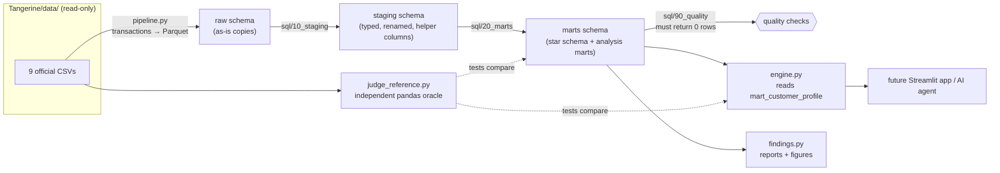
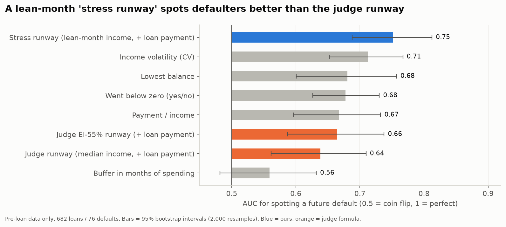
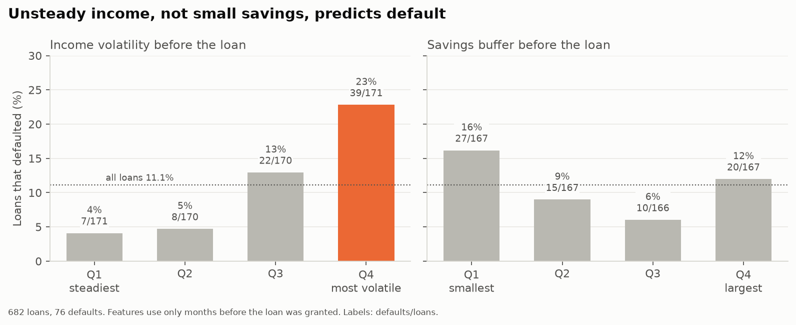
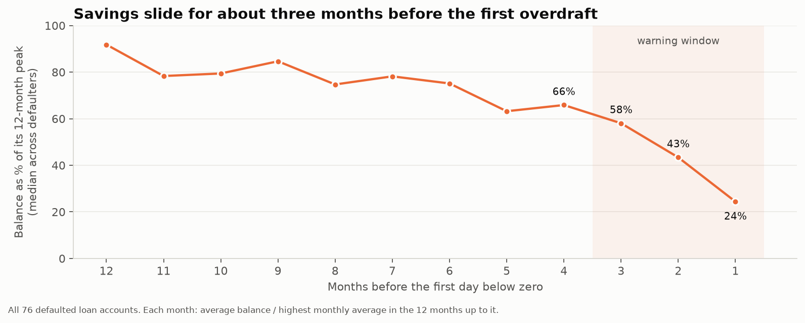
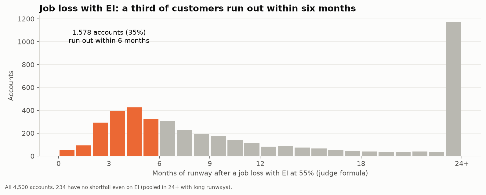

# Tangerine · Resilience Rewired — Financial Resilience Engine

**Sheridan Datathon 2026 · Tangerine track.** For any `account_id`, this engine **knows the customer**
(income, fixed costs, savings buffer, months of runway), **takes a shock** (job loss with EI, higher bills, a
surprise repair, or a mix, at any size), and **makes a plan** (an emergency-fund goal plan and a backup plan
for when the shock hits). Everything is built from the customer's own transactions.

> **Biggest finding:** the judges' runway is a **fuel gauge**. It uses a *typical* (median) month. We add a
> **check-engine light**: the **stress runway**, which is the same formula with a *lean* month's income (the customer's
> own 25th-percentile month). Using only what the bank knew *before* granting each loan, the stress runway
> ranks future defaulters far better than the judge runway: **AUC 0.75 vs 0.64** (+0.11, 95% CI +0.04 to +0.18).
> In the shortest stress-runway quarter of loans, **46 of 171 defaulted (27%)**, against 5 of 170 (3%) in the third quarter.

---

## Contents
1. [Quick start](#1-quick-start)
2. [Using the engine](#2-using-the-engine)
3. [How it works (architecture)](#3-how-it-works-architecture)
4. [The judges' numbers and our numbers](#4-the-judges-numbers-and-our-numbers)
5. [The warehouse: every table](#5-the-warehouse-every-table)
6. [Findings](#6-findings)
7. [Tests and data-quality checks](#7-tests-and-data-quality-checks)
8. [Repo layout](#8-repo-layout)
9. [Notes, differences and caveats](#9-notes-differences-and-caveats)
10. [Adding the web app later](#10-adding-the-web-app-later)
11. [Credits and sources](#11-credits-and-sources)

---

## 1. Quick start

### Get the data
The nine official CSVs go in **`Tangerine/data/`** (the datathon pack). `transactions.csv` (~100 MB) is too big for
GitHub and is git-ignored, so copy it from the datathon pack into `Tangerine/data/` yourself. Nothing in this
project ever writes to `Tangerine/data/`.

### Option A: Docker (same result on any laptop)
Start Docker Desktop, then from this folder:

```bash
docker compose build                 # once
docker compose run --rm pipeline     # build warehouse/tangerine.duckdb from the CSVs (~5 s) + quality checks
docker compose run --rm test         # 46 tests: quality checks, judge parity, engine
docker compose run --rm findings     # reports/findings.md, showcase.md, data_dictionary.md, figures/
docker compose run --rm engine 20111 --shock furnace_1_month   # one account from the command line
docker compose up notebook           # JupyterLab at http://localhost:8888
```
If you have `make`, `make all` runs build → pipeline → test → findings.

### Option B: Plain Python (3.12+)
```bash
pip install -r requirements.txt
```
PowerShell:
```powershell
$env:PYTHONPATH = "src"
python -m tangerine.pipeline
python -m pytest -q
python -m tangerine.findings
python -m tangerine.engine 20111 --shock job_loss_plus_bills
```
bash / zsh: the same commands, with `export PYTHONPATH=src` on the first line.

**`ModuleNotFoundError: No module named 'duckdb'` in a notebook?** The notebook kernel is a different Python
from the one you installed into (e.g. Anaconda vs python.org). Install into the kernel's Python: run
`%pip install -r ../requirements.txt` in a notebook cell, then restart the kernel.

---

## 2. Using the engine

### From the command line
```text
$ python -m tangerine.engine 20111 --shock job_loss_plus_bills
Account 20111 - shock: income at 55% of typical, household bills +15%
  Typical income (I)      $    6,339.39/month
  Fixed costs (F)         $    2,330.06/month
  Typical spending (S)    $    8,599.60/month
  Household bills (H)     $        0.00/month
  Buffer (B)              $   17,611.86
  Running loan pmt (P)    $    2,330.19/month
  Runway, no shock        7.8 months
  Runway, judge formula   3.4 months
  Runway, stress-adjusted 2.2 months   (lean month: $1,185 in, $652 after the shock)
  Goal plan:   Spending is above income in a typical month, so saving needs a cut: ...
  Backup plan: If the shock hits (...): ... Runway goes from 3.4 months to 6.1 months. ...
  ! Volatile income (variation 1.15): a lean month brings only $1,185 vs a typical $6,339. ...
  ! Loan status D: the loan is running and the client is already in debt.
```

### From Python (a notebook, a future app, or an AI agent)
```python
from tangerine.engine import run, Shock, PRESETS

result = run(20111, "job_loss_ei55")          # a preset twist card
result = run(20111, Shock(income_factor=0.55, duration_months=6,     # EI at 55% for 6 months, then nothing,
                          bills_increase_pct=0.15))                   # plus bills +15%
result["judge_runway"]["months"]   # 3.4   (None means "no shortfall (120+)")
result["stress_runway"]["label"]   # "2.2 months"
result["plan"]["goal_summary"]     # the emergency-fund plan, in words
result["notes"]                    # warnings: pensioner, volatile income, loan in debt, ...
```
`run()` returns one **JSON-ready dict** (no NaN or infinity anywhere) with these keys:

| Key | What it holds |
|---|---|
| `profile` | Every column of `mart_customer_profile` for the account (judge numbers, context, risk features, flags) |
| `judge_runway_no_shock` / `judge_runway` | Runway by the **official formula**, before and after the shock: months, label, income/spending after the shock, gap, buffer left |
| `stress_runway` | **Our** runway: same formula, income = a lean month |
| `simulation` | Month-by-month balance for baseline and shocked cases (handles "EI for 6 months, then nothing"), plus the first month the balance goes below zero |
| `plan` | Goal plan (target buffer, monthly saving, months to goal) and backup plan (cuts, new runway, the cut needed for 6 months of runway) |
| `notes` | Plain-English warnings to say out loud in the demo |

After the first call loads the profiles into memory, each `run()` takes **about 3 ms**.

### Twist cards → code

| Twist card (from the brief) | Preset name | `Shock(...)` |
|---|---|---|
| Laid off, EI pays 55% | `job_loss_ei55` | `Shock(income_factor=0.55)` |
| …for 6 months, then nothing | `ei55_6_months` | `Shock(income_factor=0.55, duration_months=6)` |
| Household bills up 15% | `bills_up_15` | `Shock(bills_increase_pct=0.15)` |
| Furnace dies, costs a month of spending | `furnace_1_month` | `Shock(one_off_months_of_spending=1)` |
| Job loss (EI 55%) **and** bills +15% | `job_loss_plus_bills` | `Shock(income_factor=0.55, bills_increase_pct=0.15)` |
| Any size: e.g. $4,000 repair + rent +25% | — | `Shock(one_off_cost=4000, bills_increase_pct=0.25)` |

The judge runway always assumes the shock lasts for good (as the brief's formula does). `duration_months`
only changes the month-by-month `simulation`.

**Rehearsal accounts** for the live twist (a pensioner, a volatile cash earner, a defaulter with a visible
balance slide, a comfortable saver, a negative buffer) are in [`reports/showcase.md`](reports/showcase.md).

---

## 3. How it works (architecture)



- **One file, no server:** everything lives in `warehouse/tangerine.duckdb`, so nothing can go down during the live demo.
- **Plain SQL, layered like dbt:** `pipeline.py` runs every `.sql` file in `sql/00_raw → 10_staging → 20_marts`
  in filename order, then every check in `sql/90_quality`. Each file is idempotent (`create or replace`).
  A full rebuild takes about 5 seconds.
- **Every column is described inside the database** (`comment on column ...`). [`reports/data_dictionary.md`](reports/data_dictionary.md)
  is generated from those comments.
- **Thresholds live in one place:** `src/tangerine/config.py` → copied to `marts.config_thresholds`, so SQL and
  Python always agree.
- **An independent oracle:** `judge_reference.py` re-implements the judge formulas in pandas, straight from the
  CSVs, without importing any of our code. The tests check that the warehouse and the engine match it.

---

## 4. The judges' numbers and our numbers

### Judge numbers: exact official definitions, never replaced
All from `monthly_summary.csv`, per account, over **all** months including quiet ones:

| Judge symbol | Column name | Definition |
|---|---|---|
| **I** typical money in | `typical_income` | median of `money_in` |
| **F** fixed costs | `typical_fixed_costs` | median of `household_bills + insurance + loan_payments` (shown, not used in runway) |
| **S** typical spending | `typical_spending` | median of `money_out` |
| **H** household bills | `typical_household_bills` | median of `household_bills` (rent and utility shocks scale this) |
| **B** buffer | `buffer` | mean of `avg_daily_balance` over the account's last 6 months |
| **P** loan payment | `running_loan_payment` | `monthly_payment` if the loan is still running at end of 2025 (status C or D), else 0 |

**Runway** (months), from the brief:
```
buffer_left = B - one_off_costs
gap         = spending_after_shock - income_after_shock
buffer_left <= 0  → 0
gap <= 0          → "no shortfall (120+)"
otherwise         → min(buffer_left / gap, 120), rounded to 1 decimal
```
It is written once in SQL (`marts.judge_runway()` macro), once in the engine (`engine.runway_formula`) and once
in the oracle (`judge_reference.runway`), and the tests check that all three agree.

### Our numbers: always shown *beside* the judge numbers
| Column | Meaning | Why |
|---|---|---|
| `lean_month_income_p25` | the customer's own 25th-percentile month of income | the income in a bad-but-normal month |
| **stress runway** | the judge formula with income = `lean_month_income_p25` | the "check-engine light": spots future defaulters much better (§6) |
| `typical_discretionary_spending` (D) | median of cash + card withdrawals + unlabelled transfers out | the spending a customer could cut; used by both plans |
| `income_volatility_cv` | std ÷ mean of monthly income | the strongest single warning sign |
| `lean_month_share` | share of months with income below 55% of the median | how often a month already looks like a month on EI |
| `balance_vs_12m_peak` | last month's average balance ÷ the 12-month peak | the balance slide that comes before overdrafts |

### Flags (true / false), thresholds in `config.py`
`is_volatile_income` (CV > 0.45, top quartile) · `is_pensioner` (> 30% of income from pensions) ·
`has_overdraft_history` · `is_balance_sliding` (below 50% of 12-month peak) · `has_loan_in_debt` (status D) ·
`has_short_history` (< 18 months) · `is_stale_account` (data ends before Dec 2025) · `has_negative_buffer` ·
`has_zero_income`.

### The plans
- **Goal plan (in normal times):** an emergency fund of **3 months of spending**, or **6 months** if income is
  volatile. With a surplus: save `min(surplus, 50% of surplus + 10% of D)` a month (rounded to $10), and report the
  months to reach the goal. Without a surplus: report the % cut of discretionary spending needed to reach it in
  12 months, or say plainly that cuts alone cannot reach it.
- **Backup plan (when the shock hits):** keep bills, insurance and loan payments current; cut discretionary spending
  by 30% (adjustable). Report the new runway and the cut needed to reach 6 months of runway, plus concrete steps
  (apply for EI, call the bank about the loan payment).

---

## 5. The warehouse: every table

`warehouse/tangerine.duckdb` has three schemas. The full column-by-column dictionary is in
[`reports/data_dictionary.md`](reports/data_dictionary.md).

**`raw`**: the 9 CSVs as-is (`raw.transactions` reads the Parquet copy).

**`staging`**: typed, cleaned and renamed, one table per source:

| Table | What changed |
|---|---|
| `stg_monthly_summary` | adds `month_date`, `fixed_costs`, `discretionary_spending`, `net_cash_flow` |
| `stg_accounts` | `district_id` → `branch_district_id`, `frequency` → `statement_frequency` |
| `stg_clients` | `district_id` → `home_district_id`, adds `age_years` on 2025-12-31 |
| `stg_dispositions` | `type` → `role` (owner / authorized user) |
| `stg_account_owner` | one row per account: the owner's gender and age |
| `stg_cards` | best card per account (gold > classic > junior) |
| `stg_loans` | adds `is_running` (C/D), `is_defaulted` (B/D), `loan_start_month`, `loan_end_date` |
| `stg_standing_orders` | blank `purpose` → `'other'`; `amount` → `monthly_amount` |
| `stg_districts`, `stg_transactions` | types and clearer names |

**`marts`**: what the engine, the findings and a future app read:

| Table | Grain | What it is for |
|---|---|---|
| `dim_account` | account | branch, owner, card, loan details (star-schema dimension) |
| `dim_district` | district | population, salary, unemployment, crime |
| `fact_account_month` | account × month | every monthly measure + `is_lean_month`, `was_overdrawn`, `months_from_end` |
| **`mart_customer_profile`** | account | **the engine reads only this**: judge numbers, our numbers, risk features, flags |
| `mart_shock_runways` | account | judge runway under every example twist + our stress runway |
| `mart_loan_preloan` | loan | features from the months **before** each loan (leakage-free), runways with the loan payment |
| `mart_default_drivers` | driver × quartile | default rate by quartile of each pre-loan driver |
| `mart_balance_slide` / `_summary` | defaulter × month | balance vs 12-month peak in the 12 months before the first overdraft |
| `mart_committed_obligations` | account | standing orders by purpose, as a share of income |
| `mart_findings` | finding × metric | every headline number, with n and source |
| `config_thresholds` | threshold | every threshold the flags and plans use |

Query it directly:
```python
from tangerine.pipeline import connect
con = connect(read_only=True)
con.execute("select * from marts.mart_customer_profile where account_id = 20111").df()
```

---

## 6. Findings

Full tables, sample sizes and charts: [`reports/findings.md`](reports/findings.md) (regenerated by
`python -m tangerine.findings`). Default analysis uses **only the months before each loan was granted**:
682 loans, 76 defaults.

| # | Finding | Numbers |
|---|---|---|
| **F10** | **A lean-month stress runway spots defaulters better than the judge runway** *(headline)* | AUC **0.752** vs **0.639** (judge) vs 0.559 (buffer in months). Paired bootstrap difference +0.113 [+0.044, +0.181]. Shortest stress-runway quarter: 46/171 defaulted (26.9%) |
| F1 | Going below zero before the loan = default | **27 of 27** defaulted, against 7.5% of the other 655 |
| F2 | Unsteady income, not small savings, predicts default | most volatile quarter of income: 22.8% default vs 4.1% in the steadiest. Median buffer: 1.84 months (defaulters) vs 2.01 months (others) |
| F3 | A heavy loan payment raises default risk | top quarter of payment ÷ income: 19.9% vs 4.1% |
| F4 | Savings slide for ~3 months before the first overdraft | balance at 66% → 58% → 43% → 24% of its 12-month peak, 4 → 1 months before |
| F5 | Job loss with EI 55%: a third run out within 6 months | 435 accounts under 3 months, **1,578 (35%)** under 6; only 234 have no shortfall |
| F6 | Medians hide lean months | 19% of accounts have ≥ 20% of months below 55% of their own median income |
| F7 | Pensioners break the job-loss twist | 740 accounts (16%), median owner age 71 vs 39; median EI runway 35.4 vs 7.0 months |
| F8 | Card holders are wealthier | median income $13,620 vs $5,758; buffer $35,792 vs $19,145 |
| F9 | Region barely matters | 7.8%–11.9% under 3 months of EI runway across the 8 regions |
| F11 | Part of income is already spoken for | standing orders commit a median 34% of typical income; 1,318 accounts commit over half |

<p>




</p>

The EDA story with all the intermediate tables is in [`notebooks/01_eda.ipynb`](notebooks/01_eda.ipynb).

---

## 7. Tests and data-quality checks

`python -m pytest -q` runs **46 tests** (2–8 minutes depending on the machine, mostly the all-accounts engine run):

| File | What it proves |
|---|---|
| `tests/test_quality.py` | every check in `sql/90_quality` returns 0 rows |
| `tests/test_judge_parity.py` | for **all 4,500 accounts**, I, F, S, H, B, P from SQL equal the independent pandas oracle (max difference 0.00), and the runway under every judge twist matches |
| `tests/test_engine.py` | `run()` works for all 4,500 accounts × 6 presets + 3 random shocks with no NaN/inf; the engine runway equals the oracle; population anchors (below) hold; edge cases (negative buffer → 0, zero income, pensioner note, unknown ID raises `UnknownAccount`); simulation agrees with the formula; warm `run()` < 50 ms |

**Data-quality checks** (`sql/90_quality`, also run at the end of every pipeline build): `money_in` and
`money_out` equal their parts; no duplicate account-months; every account has months; every loan has an account,
max one per account; exactly one owner per account; the profile has 4,500 rows and no NULL judge numbers; loan
amount = duration × payment; raw row counts match the brief; every runway is between 0 and 120 or "no shortfall".

**Population anchors** (judge formula, runway rounded to 1 decimal): no shock → **3,315** with no shortfall;
EI 55% → **435** under 3 months, **1,578** under 6 months, **234** with no shortfall; **23** accounts have a
negative buffer.

---

## 8. Repo layout

```
datathon2026/
├── README.md                  ← you are here
├── claude.md                  context file for AI assistants (EDA notes)
├── project prottotype.md      the build spec this repo implements
├── Dockerfile  docker-compose.yml  Makefile  requirements.txt  .gitignore  .dockerignore
├── Tangerine/
│   ├── README.md              the official brief (source of truth)
│   └── data/                  the 9 official CSVs, READ-ONLY (transactions.csv is git-ignored)
├── sql/
│   ├── 00_raw/                load CSVs / Parquet into schema raw
│   ├── 10_staging/            clean, type, rename → schema staging
│   ├── 20_marts/              star schema + analysis marts → schema marts (every column commented)
│   └── 90_quality/            data-quality checks; each must return 0 rows
├── src/tangerine/
│   ├── config.py              paths, constants, thresholds
│   ├── pipeline.py            builds the warehouse:  python -m tangerine.pipeline
│   ├── engine.py              profile / shock / runway / simulation / plan:  python -m tangerine.engine <id>
│   ├── judge_reference.py     independent pandas oracle of the judge formulas
│   └── findings.py            numbers, charts, showcase, data dictionary:  python -m tangerine.findings
├── tests/                     pytest suite (quality, parity, engine)
├── notebooks/01_eda.ipynb     narrative EDA; imports from tangerine, no copied logic
├── reports/
│   ├── findings.md            every headline number with n and source (generated)
│   ├── showcase.md            rehearsal accounts for the live twist (generated)
│   ├── data_dictionary.md     every mart column explained (generated)
│   └── figures/               pitch charts (generated)
└── warehouse/                 tangerine.duckdb + transactions.parquet (git-ignored, rebuilt by the pipeline)
```

---

## 9. Notes, differences and caveats

- **Pre-loan data only for default analysis.** "All 76 defaulters had negative days" is partly leakage (status D
  means *currently* in debt, which already shows in the balances). F1, F2, F3 and F10 use only months before the
  loan, so they are clean. 76 defaults is a small sample, so every rate is shown with its count.
- **Runway counts use the judge runway rounded to 1 decimal**, as the brief specifies. Counting on the unrounded
  value gives 454 / 1,587 under 3 / 6 months on EI. Rounding is also why 24–25 accounts show runway 0 under some
  twists although only 23 have a negative buffer (a tiny positive runway rounds to 0.0).
- **Pre-loan buffer.** Earlier exploration quoted 1.86 vs 2.03 months and an AUC of 0.593 for buffer months. This
  build uses the spec's definition (mean balance over *all* pre-loan months ÷ median pre-loan spending), which gives
  1.84 vs 2.01 months and AUC 0.559. The conclusion is the same: buffer size barely separates defaulters. 15 loans had
  a pre-loan typical spending of $0, so their buffer-in-months is undefined (n = 667).
- **Runway quartiles:** many loans tie at 120 months (no shortfall), so the split between the 3rd and 4th quarters
  depends on the tie-break (by `account_id`). The shortest quarter, which carries the finding, does not.
- **Raw data stays untouched.** The spec puts `transactions.parquet` in `data/raw/`. Here it goes in
  `warehouse/`, so `Tangerine/data/` is never written to.
- **Pensioners:** a job-loss/EI shock may not apply when most income is a pension. The engine says so in its notes
  instead of hiding the number.

---

## 10. Adding the web app later

The app only needs two things, both already in place:
```python
from tangerine.engine import run, account_ids, PRESETS, Shock   # all the logic
from tangerine.pipeline import connect                          # read-only marts for charts
```
Add an `app` service to `docker-compose.yml` that mounts `./warehouse` read-only. `run()` output is
JSON-ready, so the same call can also back an API or an AI agent's tool.

---

## 11. Credits and sources

- **PKDD'99 Discovery Challenge Financial dataset** (real anonymized bank data), CTU Prague Relational Dataset
  Repository: https://relational.fel.cvut.cz/dataset/Financial. Money converted to CAD and dates shifted to
  2020–2025 by the organizers.
- **Employment Insurance regular benefits** (Government of Canada), the basis for the 55% EI twist:
  https://www.canada.ca/en/services/benefits/ei/ei-regular-benefit.html
- Other Canadian sources listed in the brief (CPI, CMHC rents, Labour Force Survey, average weekly earnings) are
  not used for any number in this repo yet. Add their links here if a shock is sized with them.
