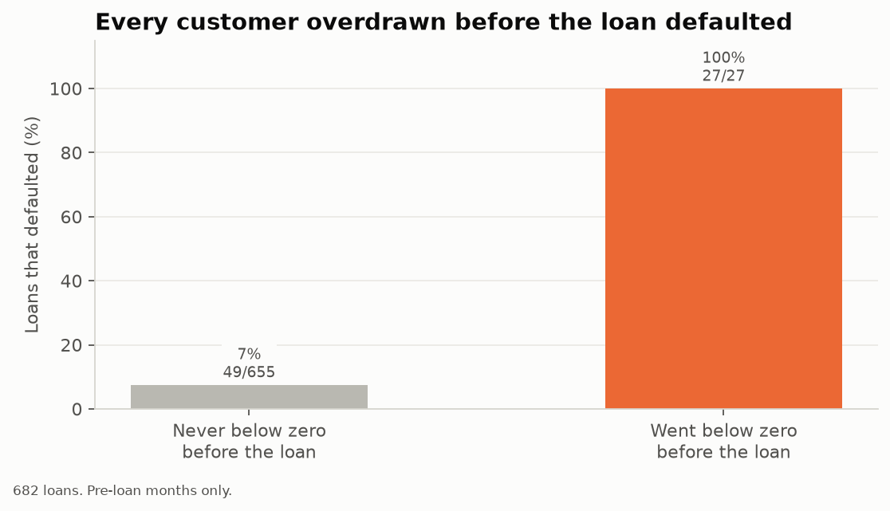
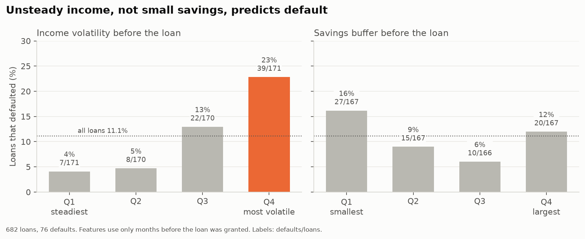
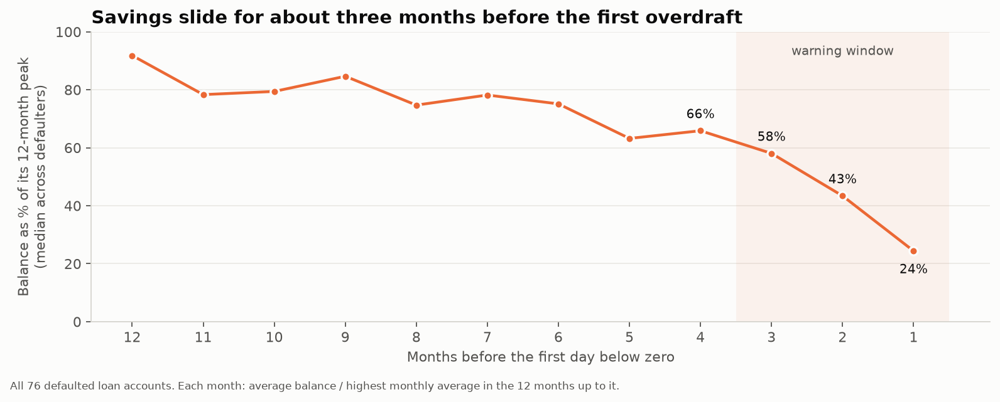
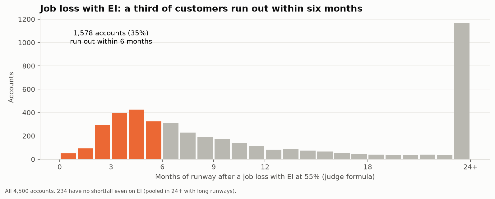
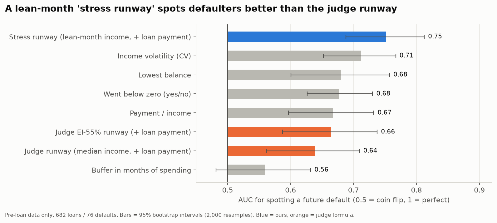
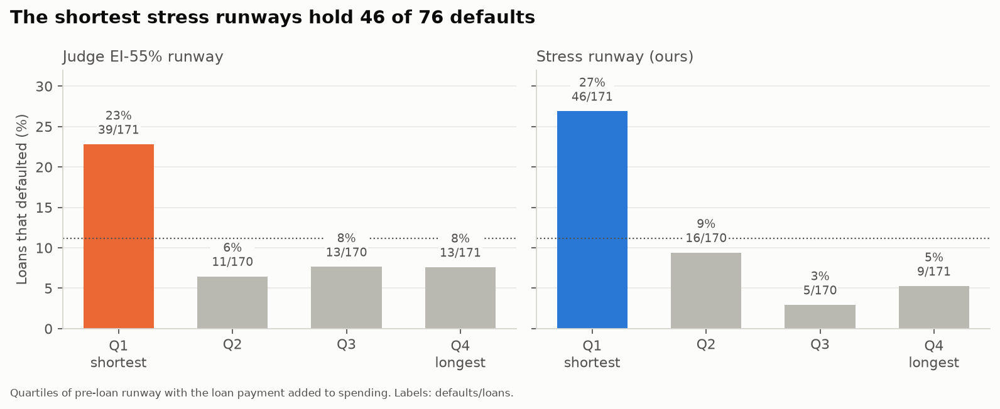

# Findings

_Generated by `python -m tangerine.findings` on 2026-11-07 23:51. Every number comes from a mart in `warehouse/tangerine.duckdb` (column **source**). Shares are shown as percentages; **n** is the sample size behind the number._

## F1 · Going below zero before the loan predicts default

| Metric | Value | n | Source |
|---|---:|---:|---|
| loans whose account went below zero before the loan | 27 | 27 | `mart_loan_preloan` |
| default rate of those loans | 100.0% | 27 | `mart_loan_preloan` |
| default rate of loans that never went below zero before | 7.5% | 655 | `mart_loan_preloan` |

## F2 · Unsteady income, not small savings, predicts default

| Metric | Value | n | Source |
|---|---:|---:|---|
| default rate, Q1 (lowest) of pre-loan income volatility | 4.1% | 171 | `mart_default_drivers` |
| default rate, Q4 (highest) of pre-loan income volatility | 22.8% | 171 | `mart_default_drivers` |
| median pre-loan buffer (months of spending), non-defaulters | 2.01 | 606 | `mart_loan_preloan` |
| median pre-loan buffer (months of spending), defaulters | 1.84 | 76 | `mart_loan_preloan` |

## F3 · A heavy loan payment raises default risk

| Metric | Value | n | Source |
|---|---:|---:|---|
| default rate, Q1 (lowest) of payment / income | 4.1% | 171 | `mart_default_drivers` |
| default rate, Q4 (highest) of payment / income | 19.9% | 171 | `mart_default_drivers` |

## F4 · Savings slide for ~3 months before the first overdraft

| Metric | Value | n | Source |
|---|---:|---:|---|
| median balance as share of 12-month peak, 1 month(s) before first overdraft | 24.4% | 76 | `mart_balance_slide_summary` |
| median balance as share of 12-month peak, 2 month(s) before first overdraft | 43.4% | 76 | `mart_balance_slide_summary` |
| median balance as share of 12-month peak, 3 month(s) before first overdraft | 58.1% | 76 | `mart_balance_slide_summary` |
| median balance as share of 12-month peak, 4 month(s) before first overdraft | 65.9% | 76 | `mart_balance_slide_summary` |

## F5 · Job loss with EI 55%: a third of customers run out within 6 months

| Metric | Value | n | Source |
|---|---:|---:|---|
| accounts with runway 0 (buffer already gone) | 25 | 4,500 | `mart_shock_runways` |
| accounts that run out in under 3 months (incl. 0) | 435 | 4,500 | `mart_shock_runways` |
| accounts that run out in under 6 months (incl. 0) | 1,578 | 4,500 | `mart_shock_runways` |
| accounts with no shortfall even on EI | 234 | 4,500 | `mart_shock_runways` |
| accounts with no shortfall and no shock | 3,315 | 4,500 | `mart_shock_runways` |

## F6 · Medians hide lean months

| Metric | Value | n | Source |
|---|---:|---:|---|
| share of accounts where >= 20% of months had income below 55% of their own median | 19.1% | 4,500 | `mart_customer_profile` |

## F7 · Pensioners break the job-loss twist

| Metric | Value | n | Source |
|---|---:|---:|---|
| pensioner accounts (> 30% of income from pensions) | 740 | 4,500 | `mart_customer_profile` |
| median owner age, pensioners | 71.0 | 740 | `mart_customer_profile` |
| median owner age, others | 39.0 | 3,760 | `mart_customer_profile` |
| median EI-55% runway (no shortfall = 120), pensioners | 35.4 | 740 | `mart_shock_runways` |
| median EI-55% runway (no shortfall = 120), others | 7.00 | 3,760 | `mart_shock_runways` |

## F8 · Card holders are wealthier

| Metric | Value | n | Source |
|---|---:|---:|---|
| median typical income (I), card holders | $13,620 | 892 | `mart_customer_profile` |
| median typical income (I), no card | $5,758 | 3,608 | `mart_customer_profile` |
| median buffer (B), card holders | $35,792 | 892 | `mart_customer_profile` |
| median buffer (B), no card | $19,145 | 3,608 | `mart_customer_profile` |

## F9 · Region barely matters

| Metric | Value | n | Source |
|---|---:|---:|---|
| lowest regional share under 3 months of EI runway | 7.8% | 4,500 | `mart_shock_runways` |
| highest regional share under 3 months of EI runway | 11.9% | 4,500 | `mart_shock_runways` |

## F10 · A lean-month stress runway spots defaulters better than the judge runway (headline)

Pre-loan data only (what the bank knew when it said yes). Higher AUC = better at ranking future defaulters above good payers; 0.5 = coin flip.

| Score | AUC | 95% CI | n loans |
|---|---:|---:|---:|
| Stress runway (lean-month income, + loan payment) | 0.752 | 0.688 – 0.812 | 682 |
| Income volatility (CV) | 0.712 | 0.652 – 0.767 | 682 |
| Lowest balance | 0.681 | 0.600 – 0.757 | 682 |
| Went below zero (yes/no) | 0.678 | 0.627 – 0.730 | 682 |
| Payment / income | 0.667 | 0.597 – 0.732 | 682 |
| Judge EI-55% runway (+ loan payment) | 0.665 | 0.587 – 0.738 | 682 |
| Judge runway (median income, + loan payment) | 0.639 | 0.561 – 0.710 | 682 |
| Buffer in months of spending | 0.559 | 0.482 – 0.632 | 667 |

Paired bootstrap (2,000 resamples of the same loans):

| Comparison | AUC difference | 95% CI | share of draws ≤ 0 |
|---|---:|---:|---:|
| stress - judge runway | +0.113 | +0.048 – +0.180 | 0.000 |
| stress - buffer months | +0.193 | +0.113 – +0.277 | 0.000 |

Source: `mart_loan_preloan`, `mart_default_drivers`; AUC computed in `findings.py`.

## F11 · A slice of income is already spoken for

| Metric | Value | n | Source |
|---|---:|---:|---|
| median share of typical income committed by standing orders (accounts with income > 0) | 33.9% | 4,486 | `mart_committed_obligations` |
| accounts committing more than half their typical income | 1,318 | 4,500 | `mart_committed_obligations` |

## Caveats

- 76 defaults is a small sample: every rate is shown with its count.
- "All defaulters had negative days" is partly leakage (status D = currently in debt). The **pre-loan** version (F1: 27 of 27) is clean, and F2, F3 and F10 also use pre-loan months only.
- Runway counts use the judge runway **rounded to 1 decimal**, as the brief specifies. Counting on the unrounded value gives slightly higher numbers (454 under 3 months, 1,587 under 6 on EI).
- Runway quartiles: many loans tie at 120 months (no shortfall), so the Q3/Q4 split depends on the tie-break (account_id). The Q1 group, which carries the finding, does not.
- 15 loans had a pre-loan typical spending of $0, so their buffer-in-months is undefined and left out of that AUC (n = 667).
